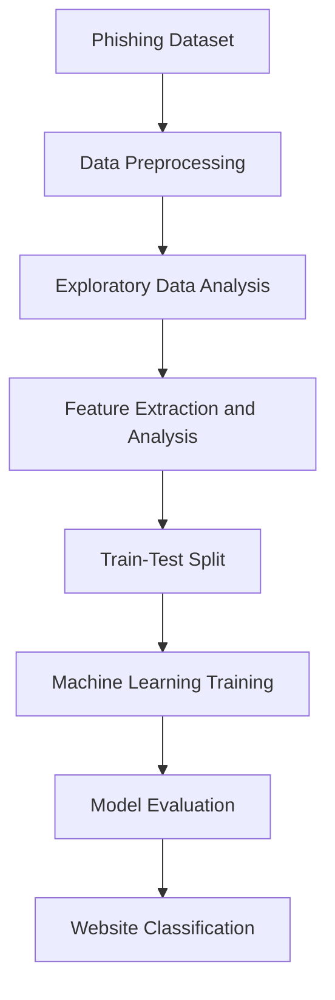

# 🛡️ Phishing Website Detection | Machine Learning

Intelligent URL Classification for Identifying Potential Phishing Websites

---

## Overview

**Phishing Website Detection** is a Machine Learning-based cybersecurity project designed to identify potentially malicious and phishing websites by analyzing URL-based characteristics and website features.

The system uses supervised machine learning techniques to classify websites as legitimate or phishing based on patterns learned from a dataset. It focuses on identifying suspicious URL structures and characteristics that may indicate phishing activity.

The project combines data preprocessing, exploratory data analysis, feature analysis, model training, and performance evaluation to develop a phishing detection system.

## Key Features

- **URL Analysis:** Analyze website URLs and their structural characteristics.
- **Feature Extraction:** Extract relevant features for machine learning classification.
- **Data Preprocessing:** Prepare dataset features for model training.
- **Exploratory Data Analysis:** Analyze phishing and legitimate website patterns.
- **Machine Learning Classification:** Train supervised learning models to classify URLs.
- **Model Evaluation:** Measure performance using classification metrics.
- **Prediction System:** Predict whether a website is likely legitimate or phishing.

## Tech Stack

| Technology | Purpose |
|---|---|
| Python | Core programming language |
| Pandas | Data manipulation and analysis |
| NumPy | Numerical computation |
| Matplotlib | Data visualization |
| Seaborn | Statistical visualization |
| Scikit-learn | Machine learning and evaluation |
| Jupyter Notebook | Model development and experimentation |

## Machine Learning Models

The project can implement and compare the following machine learning algorithms:

- Logistic Regression
- Decision Tree Classifier
- Random Forest Classifier
- Support Vector Machine (SVM)
- K-Nearest Neighbors (KNN)

<text color="secondary" size="sm">Update this list according to the models actually implemented in your project.</text>

## Dataset

The project utilizes a phishing website dataset containing URL-related and website characteristics used to classify phishing and legitimate websites.

### Common Features

| Feature | Description |
|---|---|
| URL Length | Length of the website URL |
| IP Address | Whether the URL uses an IP address |
| HTTPS | HTTPS-related URL characteristic |
| Prefix-Suffix | Presence of suspicious hyphens in domain-related features |
| Subdomain | Subdomain-related characteristics |
| Redirect | Redirect-related URL characteristics |
| Special Characters | Presence of unusual URL characters |
| Domain Information | Domain-related characteristics |
| Target | Website classification label |

<text color="secondary" size="sm">Feature descriptions depend on the specific dataset used in this project.</text>

## Project Workflow



## Model Evaluation

The classification models are evaluated using:

- **Accuracy:** Overall prediction correctness.
- **Precision:** Correct phishing predictions among predicted phishing cases.
- **Recall:** Ability to identify actual phishing websites.
- **F1-Score:** Balance between precision and recall.
- **Confusion Matrix:** Analysis of classification errors.

## Project Structure

```text
Phishing-Website-Detection/
│
├── dataset/
│   └── phishing.csv
│
├── notebook/
│   └── phishing_detection.ipynb
│
├── README.md
├── requirements.txt
└── .gitignore
```

## Installation & Setup

### 1. Clone the Repository

```bash
git clone https://github.com/your-username/phishing-website-detection.git
```

### 2. Navigate to the Project Directory

```bash
cd phishing-website-detection
```

### 3. Install Dependencies

```bash
pip install -r requirements.txt
```

### 4. Launch Jupyter Notebook

```bash
jupyter notebook
```

Open the notebook and execute the cells to perform data analysis, train models, evaluate performance, and generate predictions.

## Requirements

```text
pandas
numpy
matplotlib
seaborn
scikit-learn
jupyter
```

## Future Scope

- Develop a real-time URL scanning interface.
- Integrate threat intelligence APIs.
- Implement automated URL feature extraction.
- Add domain reputation analysis.
- Integrate SSL certificate analysis.
- Build a web-based phishing detection dashboard.
- Explore Explainable AI for interpreting predictions.

## Disclaimer

This project is developed for educational, research, and cybersecurity awareness purposes. Machine learning predictions are probabilistic and may produce false positives or false negatives. A website classified as legitimate should not automatically be considered safe.

---

